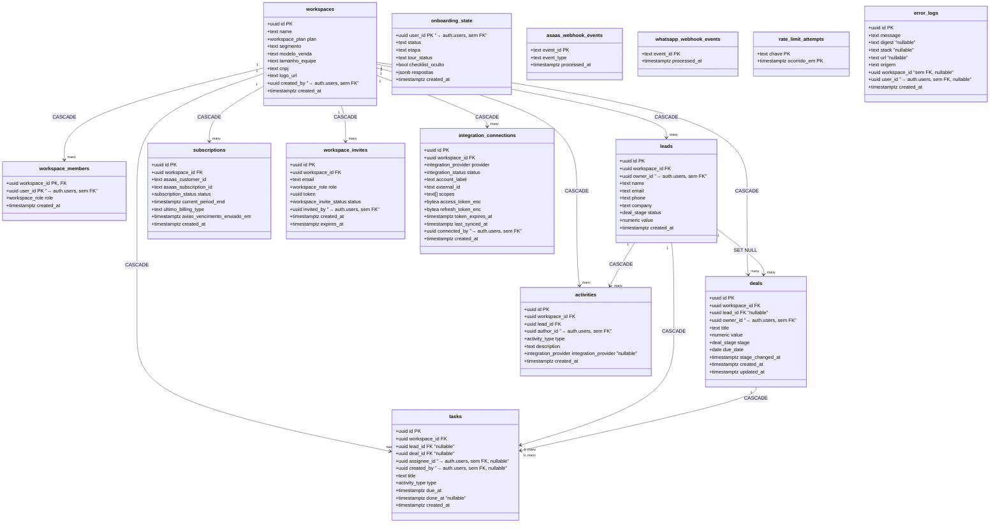

# Schema do Velo Funil — engenharia reversa via catálogo Postgres

**Fonte:** projeto Supabase `velofunil-sao-paulo` (`tmyeunithjqkbwvezyyn`, sa-east-1),
inspecionado em 18/08/2026 via `information_schema` e `pg_catalog`, sem
suposição — toda tabela, coluna, chave e enum abaixo veio de consulta real.
Migrations novas mudam este arquivo com o tempo; ao suspeitar de
desatualização, reconsulte o catálogo em vez de confiar cegamente nele (mesma
regra de `docs/estado-atual.md`).

**Reconferido em 22/08/2026 — mudou.** A migration 0047 (WhatsApp pelo
Evolution) acrescentou a **14ª tabela**, `whatsapp_webhook_events`, mais um
índice funcional em `leads` e três funções. Conferido contra o banco real, não
contra a migration: o documento OpenAPI do PostgREST em produção lista hoje 14
tabelas e 29 RPCs, entre elas `encontrar_lead_por_telefone`,
`telefone_normalizado` e `purge_old_whatsapp_webhook_events`.

O índice novo é **funcional e parcial**, o que não aparece numa listagem de
colunas e por isso fica registrado aqui:

```sql
create index leads_telefone_ultimos8_idx
  on public.leads (workspace_id, right(regexp_replace(phone, '\D', '', 'g'), 8))
  where phone is not null;
```

Ele existe porque casar telefone de mensagem recebida varria todos os leads do
workspace e comparava em JavaScript — com 3.000 leads, cada "oi" custava 3.000
linhas. O risco aceito está no comentário da própria migration: dois leads com
os mesmos 8 dígitos finais em DDDs diferentes colidem; é raro, e anexar ao lead
errado é reparável, ao contrário de perder a mensagem.

**Registro anterior, de 20/08/2026, mantido:** A Central do Dono (`/dono`,
rota local) foi construída sobre o schema existente e **não criou nem alterou
nenhuma tabela, coluna ou enum** — ela só lê, e escreve pelas mesmas portas
que o produto já usava (`subscriptions`, `workspaces.plan`, a RPC
`apply_asaas_subscription_status` via `lib/asaas/aplicar-evento.ts`).
Confirmado por dois caminhos: `git diff` em `supabase/` vazio, e a lista de
tabelas expostas pelo PostgREST em produção continua nas mesmas 13
(`activities`, `asaas_webhook_events`, `deals`, `error_logs`,
`integration_connections`, `leads`, `onboarding_state`,
`rate_limit_attempts`, `subscriptions`, `tasks`, `workspace_invites`,
`workspace_members`, `workspaces`). Registrado em vez de assumido.

**Nota de metodologia.** Extraído com a ferramenta MCP Supabase
(`execute_sql`, contra o projeto de produção), 4 consultas: colunas
(`information_schema.columns`), chaves primárias e estrangeiras
(`information_schema.table_constraints` + `constraint_column_usage` +
`referential_constraints`) e enums (`pg_type`/`pg_enum`).

## Diagrama de classes

Versão renderizada, imagem única com todas as tabelas, chaves e legendas:
[schema.svg](schema.svg).

Mesmo diagrama em Mermaid, editável e legível como texto puro:



*Tabelas soltas, sem FK para nenhuma outra do schema `public`:
`asaas_webhook_events` (dedupe de webhook do Asaas),
`whatsapp_webhook_events` (dedupe de webhook do Evolution, migration 0047),
`rate_limit_attempts` (controle de tentativas de login) e `error_logs`
(captura de erro dos boundaries do produto, migration 0046).
`whatsapp_webhook_events` é a única das quatro que **nasce com purga**
(`purge_old_whatsapp_webhook_events()`, 7 dias, rodada por Vercel Cron): a
projeção de 240 mil eventos/dia com 400 clientes a levaria a 9,7 GB em 12
meses. A irmã do Asaas sobrevive sem limpeza só porque recebe poucas linhas
por mês. Aparecem no diagrama, sem linha de
relação — é o que o catálogo mostra, não omissão. `error_logs` também é
zero-policy (RLS ligada, só `service_role` acessa), mesmo padrão de
`asaas_webhook_events`.*

## Achado da inspeção: colunas que apontam para `auth.users` sem FK declarada

`deals.owner_id`, `leads.owner_id`, `tasks.assignee_id`, `tasks.created_by`,
`activities.author_id`, `workspace_invites.invited_by`,
`workspace_members.user_id`, `onboarding_state.user_id`,
`integration_connections.connected_by`, `workspaces.created_by` — todas
`uuid`, nenhuma com `FOREIGN KEY` no catálogo (confirmado pela consulta a
`referential_constraints`, que só retornou relações dentro do schema
`public`). Padrão esperado no Supabase: `auth.users` vive em outro schema,
gerenciado pelo GoTrue, e o projeto não declara FK cross-schema. A
integridade referencial para essas colunas é garantida pela aplicação
(Server Actions), não pelo banco.

## Legenda dos enums (`pg_enum`, valores reais e ordem de definição)

| Enum | Valores |
|---|---|
| `activity_type` | `ligacao`, `email`, `reuniao`, `nota` |
| `deal_stage` | `novo`, `contato_realizado`, `proposta_enviada`, `negociacao`, `fechado_ganho`, `fechado_perdido` |
| `integration_provider` | `google_calendar`, `gmail`, `whatsapp` |
| `integration_status` | `connected`, `error`, `disconnected` |
| `subscription_status` | `trialing`, `active`, `past_due`, `canceled` |
| `workspace_invite_status` | `pending`, `accepted`, `expired` |
| `workspace_plan` | `free`, `pro` |
| `workspace_role` | `admin`, `membro` |

## Resumo do catálogo

12 tabelas no schema `public`, todas com Row Level Security ligada
(`rls_enabled: true` em `list_tables`, confirmado, não suposto). 12
relações de foreign key entre tabelas do schema; a maioria com `ON DELETE
CASCADE` a partir de `workspaces`, exceto `deals.lead_id` (`SET NULL` — um
negócio sobrevive à exclusão do lead vinculado).
