# Esteira de testes do Velo Funil — como funciona de verdade

**Fonte:** leitura direta de `vitest.config.mts`, `playwright.config.ts`,
`tests/e2e/*.spec.ts`, `.github/workflows/deploy-com-auditoria.yml` e os
arquivos `lib/**/*.test.ts`. Escrito em 18/08/2026, **contagens remedidas em
04/09** — o arquivo do vitest era citado como `.ts` e é `.mts`, e o conferidor
de documentos não pegava porque ignorava caminho sem barra.

As contagens saem de `node scripts/ci/contagens.mjs`, não de memória.

**Nota de metodologia.** O pedido original descrevia um "robô rodando o
sistema inteiro a cada alteração de código" que "grita antes do cliente
perceber". Isso não existe hoje: não há CI executando a suite a cada push.
Diagramar esse fluxo como se existisse seria a mesma classe de erro que o
projeto evita em tudo o mais — "provar contra produção, não supor"
(`CLAUDE.md`). Os dois diagramas abaixo descrevem o real: testes unitários
rodados à mão antes de todo commit, e dois testes E2E, um deles com workflow
de CI **já versionado** desde 19/08 (ver "Gate de segurança no deploy", em
`docs/estado-atual.md`).

Este parágrafo dizia "não commitado" até 04/09, contradizendo o diagrama de
sequência mais abaixo neste mesmo arquivo, que já dizia o contrário. `git
ls-files .github/` resolve em um comando — e o conferidor de documentos não
pegava porque `.yml` não estava na lista de extensões que ele confere.

## O que existe, em números

<!-- contagem: testes.arquivos=147 e2e.specs=4 -->
- **147 arquivos de teste unitário** (Vitest, `lib/**/*.test.ts`), e
  **2.175 testes** na última execução, medida em 25/09.

  O carimbo era `testes.arquivos>=85` e passava limpo dizendo 65% a menos do
  que existe. Piso é a decisão certa onde o crescimento é rotineiro, e aqui ele
  tinha deixado de informar — o oposto do que acontece com o grafo, que cresce
  a cada commit. Agora é exato, e quem acrescentar um arquivo de teste atualiza
  o número junto. Cobrem só lógica pura — schema de validação, parser de
  CSV/planilha, formatador de data/telefone, medidor de força de senha,
  criptografia de token, template de e-mail. Deliberadamente sem
  componente/DOM: `vitest.config.mts` roda em `environment: 'node'`.

  O número de arquivos é declarado como **piso**: ele sobe a cada rodada, e um
  valor exato aqui estaria errado no commit seguinte. O total de casos não é
  carimbado porque obtê-lo exige rodar o vitest — contá-los estaticamente erra
  15%, por causa dos `.each`. Rode `npm test`.
- **Zero teste de integração formal.** Nada que suba um Postgres de teste e
  rode queries reais dentro da suite automatizada. A "prova contra produção"
  que o projeto pratica (RLS com sessão simulada, webhook real, etc.) é feita
  por scripts descartáveis em Node, à mão, não por uma suite que roda sozinha.
<!-- contagem: e2e.specs=4 -->
- **4 specs E2E** (Playwright), cada uma com projeto próprio no
  `playwright.config.ts`:
  - `security-audit.spec.ts` — rotas públicas, sem sessão, chave vazada,
    cabeçalhos, stack trace. É a única no CI.
  - `funil-completo.spec.ts` — cria conta e cobrança REAIS no Asaas de
    produção; fora do CI de propósito, `npm run test:funil`.
  - `produto-logado.spec.ts` — senha, planilha, convite, calendário e o portão
    do OAuth. Escreve no banco de produção, `npm run test:produto`.
  - `suporte.spec.ts` — o canal de suporte com e-mail saindo de verdade,
    `npm run test:suporte`.

  Eram 2 até 18/08 e o documento nunca foi atualizado; as duas novas trouxeram
  scripts próprios ao `package.json` que este arquivo também não citava.
- **1 workflow de CI, versionado**:
  `.github/workflows/deploy-com-auditoria.yml` builda, roda
  `security-audit.spec.ts` contra um deploy de preview e publica o link para
  promoção. Os três passos manuais que faltavam — arquivo no repositório,
  Secrets, desligar o auto-deploy — foram concluídos em 19/08. **A promoção
  final continua sendo manual**, e não por descuido: `POST /promote` devolve
  `422` para deployment de target `staging`, testado inclusive já com Vercel
  Pro contratado.

## Diagrama de classes — o que cada teste cobre

```mermaid
classDiagram
    class TestesUnitarios {
        <<Vitest — lib/**/*.test.ts>>
        145 arquivos, 2.130 testes
        environment: node
    }

    class ValidacaoDeSchema {
        validations/task.test.ts
        validations/deal.test.ts
        validations/auth.test.ts
        validations/billing.test.ts
        validations/workspace.test.ts
        validations/perfil.test.ts
        validations/mascaras.test.ts
    }

    class LogicaDeNegocio {
        tasks/buckets.test.ts
        tasks/tipo-sugerido.test.ts
        deals/parado.test.ts
        deals/metrics.test.ts
        dashboard/periodo.test.ts
        calendario/grade-do-mes.test.ts
        calendario/semana.test.ts
        kanban/urgencia.test.ts
        onboarding/checklist.test.ts
    }

    class ParsingEFormatacao {
        leads/csv.test.ts
        leads/planilha.test.ts
        leads/whatsapp.test.ts
        documento-br.test.ts
        format-input.test.ts
        password-strength.test.ts
    }

    class SegurancaCriptografia {
        integrations/crypto.test.ts
        integrations/state.test.ts
        request-ip.test.ts
        storage/logo.test.ts
    }

    class TemplatesDeEmail {
        emails/convite.test.ts
        emails/layout.test.ts
        emails/pagamento-atrasado.test.ts
        emails/pagamento-confirmado.test.ts
        emails/plano-vencendo.test.ts
    }

    class E2ESecurityAudit {
        <<Playwright — roda no workflow, sem sessão>>
        tests/e2e/security-audit.spec.ts
        chave vazada em HTML/JS público
        headers de segurança (CSP, HSTS...)
        stack trace em erro de API
        contra deploy de PREVIEW
    }

    class E2EFunilCompleto {
        <<Playwright — SÓ manual, npm run test:funil>>
        tests/e2e/funil-completo.spec.ts
        cria conta REAL
        cria cobrança REAL no Asaas
        cancela no fim (helpers/limpeza.ts)
        FORA do CI de propósito
    }

    class WorkflowCI {
        <<.github/workflows/deploy-com-auditoria.yml>>
        VERSIONADO desde 19/08
        tsc + lint + test + build, depois security-audit
        promove: o clique final continua manual
    }

    class BancoDeProducao {
        <<tocado só por scripts manuais, nunca por CI>>
        RLS testada com sessão simulada
        webhook testado com evento real
    }

    TestesUnitarios --> ValidacaoDeSchema
    TestesUnitarios --> LogicaDeNegocio
    TestesUnitarios --> ParsingEFormatacao
    TestesUnitarios --> SegurancaCriptografia
    TestesUnitarios --> TemplatesDeEmail

    E2ESecurityAudit --> WorkflowCI : "pretende rodar em"
    E2EFunilCompleto --> BancoDeProducao : "cria/cancela dado real"
```

## Diagrama de sequência — o fluxo real hoje (sem CI)

## O que falta para o "robô" do slide existir de verdade

**Os três primeiros itens desta lista foram concluídos em 19/08, e a lista
continuou pedindo por eles até 23/09.** Ficam registrados, riscados, porque ler
"falta pôr o workflow no repositório" sobre um workflow versionado é o tipo de
afirmação que faz alguém refazer trabalho feito:

    [x] por `deploy-com-auditoria.yml` no repositorio
    [x] secrets da Vercel no GitHub, e desligar o deploy automatico
    [x] somar `npm test` ao workflow — os quatro portoes rodam la desde
        que o arquivo entrou: `tsc`, `lint`, `test` e `build`

1. **Alerta automático quando `error_logs` recebe uma linha nova** — hoje é
   consulta manual (SQL/MCP), sem push/e-mail/Slack quando algo quebra.

Este é o único que continua de pé. O diagrama de sequência acima
é o estado real; a lista acima é o caminho até o estado que o slide descreve.
