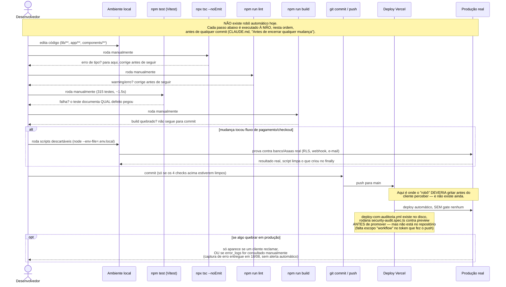

# Esteira de testes do Velo Funil — como funciona de verdade

**Fonte:** leitura direta de `vitest.config.ts`, `playwright.config.ts`,
`tests/e2e/*.spec.ts`, `.github/workflows/deploy-com-auditoria.yml` e os 30
arquivos `lib/**/*.test.ts`, em 18/08/2026. Sem suposição — o que não existe
está marcado como não existe, não fica implícito.

**Nota de metodologia.** O pedido original descrevia um "robô rodando o
sistema inteiro a cada alteração de código" que "grita antes do cliente
perceber". Isso não existe hoje: não há CI executando a suite a cada push.
Diagramar esse fluxo como se existisse seria a mesma classe de erro que o
projeto evita em tudo o mais — "provar contra produção, não supor"
(`CLAUDE.md`). Os dois diagramas abaixo descrevem o real: testes unitários
rodados à mão antes de todo commit, e dois testes E2E, um deles com workflow
de CI pronto no disco mas **não commitado** (bloqueio de escopo de token,
ver `docs/estado-atual.md`, "Gate de segurança no deploy").

## O que existe, em números

- **30 arquivos de teste unitário** (Vitest, `lib/**/*.test.ts`), 315 testes,
  ~1.5s de execução. Cobrem só lógica pura — schema de validação, parser de
  CSV/planilha, formatador de data/telefone, medidor de força de senha,
  criptografia de token, template de e-mail. Deliberadamente sem
  componente/DOM: `vitest.config.ts` roda em `environment: 'node'`.
- **Zero teste de integração formal.** Nada que suba um Postgres de teste e
  rode queries reais dentro da suite automatizada. A "prova contra produção"
  que o projeto pratica (RLS com sessão simulada, webhook real, etc.) é feita
  por scripts descartáveis em Node, à mão, não por uma suite que roda sozinha.
- **2 specs E2E** (Playwright): `security-audit.spec.ts` (rotas públicas, sem
  sessão, chave vazada/headers/stack trace) e `funil-completo.spec.ts` (cria
  conta e cobrança REAIS no Asaas de produção — por isso fica fora do CI de
  propósito, rodado só à mão via `npm run test:funil`).
- **1 workflow de CI no disco, não no repositório**:
  `.github/workflows/deploy-com-auditoria.yml` builda, roda
  `security-audit.spec.ts` contra um deploy de preview, e só promoveria para
  produção se passar. Nunca rodou de verdade: falta o arquivo estar no git
  (push recusado por falta do escopo `workflow` no token), os secrets da
  Vercel, e desligar o deploy automático nativo que ainda promove sozinho.

## Diagrama de classes — o que cada teste cobre

```mermaid
classDiagram
    class TestesUnitarios {
        <<Vitest — lib/**/*.test.ts>>
        30 arquivos, 315 testes
        environment: node
        ~1.5s de execução
    }

    class ValidacaoDeSchema {
        validations/task.test.ts
        validations/deal.test.ts
        validations/auth.test.ts
        validations/billing.test.ts
        validations/workspace.test.ts
        validations/perfil.test.ts
        validations/mascaras.test.ts
    }

    class LogicaDeNegocio {
        tasks/buckets.test.ts
        tasks/tipo-sugerido.test.ts
        deals/parado.test.ts
        deals/metrics.test.ts
        dashboard/periodo.test.ts
        calendario/grade-do-mes.test.ts
        calendario/semana.test.ts
        kanban/urgencia.test.ts
        onboarding/checklist.test.ts
    }

    class ParsingEFormatacao {
        leads/csv.test.ts
        leads/planilha.test.ts
        leads/whatsapp.test.ts
        documento-br.test.ts
        format-input.test.ts
        password-strength.test.ts
    }

    class SegurancaCriptografia {
        integrations/crypto.test.ts
        integrations/state.test.ts
        request-ip.test.ts
        storage/logo.test.ts
    }

    class TemplatesDeEmail {
        emails/convite.test.ts
        emails/layout.test.ts
        emails/pagamento-atrasado.test.ts
        emails/pagamento-confirmado.test.ts
        emails/plano-vencendo.test.ts
    }

    class E2ESecurityAudit {
        <<Playwright — roda no workflow, sem sessão>>
        tests/e2e/security-audit.spec.ts
        chave vazada em HTML/JS público
        headers de segurança (CSP, HSTS...)
        stack trace em erro de API
        contra deploy de PREVIEW
    }

    class E2EFunilCompleto {
        <<Playwright — SÓ manual, npm run test:funil>>
        tests/e2e/funil-completo.spec.ts
        cria conta REAL
        cria cobrança REAL no Asaas
        cancela no fim (helpers/limpeza.ts)
        FORA do CI de propósito
    }

    class WorkflowCI {
        <<.github/workflows/deploy-com-auditoria.yml>>
        EXISTE NO DISCO, NÃO NO REPOSITÓRIO
        build → security-audit → promove prod
        nunca rodou de verdade
    }

    class BancoDeProducao {
        <<tocado só por scripts manuais, nunca por CI>>
        RLS testada com sessão simulada
        webhook testado com evento real
    }

    TestesUnitarios --> ValidacaoDeSchema
    TestesUnitarios --> LogicaDeNegocio
    TestesUnitarios --> ParsingEFormatacao
    TestesUnitarios --> SegurancaCriptografia
    TestesUnitarios --> TemplatesDeEmail

    E2ESecurityAudit --> WorkflowCI : "pretende rodar em"
    E2EFunilCompleto --> BancoDeProducao : "cria/cancela dado real"
```

## Diagrama de sequência — o fluxo real hoje (sem CI)

## O que falta para o "robô" do slide existir de verdade

1. **Colocar `deploy-com-auditoria.yml` no repositório.** Precisa de um
   `git push` com token/PAT com escopo `workflow`, ou upload manual pelo
   painel do GitHub — já documentado em `docs/estado-atual.md`, "Gate de
   segurança no deploy".
2. **Secrets da Vercel no GitHub** (`VERCEL_TOKEN`, `VERCEL_ORG_ID`,
   `VERCEL_PROJECT_ID`) e **desligar o deploy automático nativo da Vercel**
   para `main` — sem isso a Vercel promove em paralelo ao Actions e o gate
   não impede nada.
3. **Somar `npm test` ao workflow**, hoje ele só roda `security-audit.spec.ts`
   E2E; os 315 testes unitários não fazem parte do gate de CI nenhum, só do
   checklist manual do desenvolvedor.
4. **Alerta automático quando `error_logs` recebe uma linha nova** — hoje é
   consulta manual (SQL/MCP), sem push/e-mail/Slack quando algo quebra.

Nenhum destes é grande, mas nenhum está feito. O diagrama de sequência acima
é o estado real; a lista acima é o caminho até o estado que o slide descreve.
